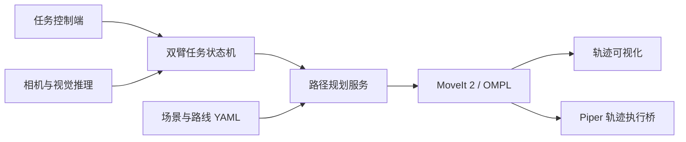

# Dual Piper Path Planning Service

基于 ROS 2 Jazzy 与 MoveIt 2 的双 Piper 机械臂路径规划工作空间。提供位姿、关节与笛卡尔路径服务，支持静态场景碰撞检查、多段 OMPL 途径点，以及上架和拣货任务的阶段编排。



## 功能

- `/plan_to_pose`、`/plan_to_pose_v2`、`/plan_to_pose_v3`：目标位姿规划；V2 支持抓取物几何，V3 支持规划器选择和多段途径点。
- `/plan_to_joints`、`/plan_cartesian_path`：关节目标与笛卡尔路径规划。
- 静态场景、双臂 SRDF、关节限位和路线配置位于 `src/path_planning_server/config/`。
- 上层状态机按 OMPL 搬运、笛卡尔接近与回退等阶段组织抓取任务。
- 虚拟入口可在 RViz 中查看规划轨迹；硬件入口连接 Piper 轨迹桥执行。

## 工作空间

| 路径 | 内容 |
| --- | --- |
| `src/path_planning_interfaces/` | ROS 消息与服务定义 |
| `src/path_planning_server/` | C++ 规划服务、Python 任务状态机、MoveIt 配置与测试 |
| `src/piper_ros/` | Piper 驱动与机器人描述，保留上游 MIT 许可 |
| `tools/` | 双臂 URDF 生成工具 |

## 构建与虚拟运行

安装 ROS 2 Jazzy、MoveIt 2、colcon 和 `package.xml` 中声明的依赖。用于高层抓取任务的 `graspnet_bridge_interfaces` 由对应的桥接工作空间提供。

```bash
git clone https://github.com/GuanliLee/path_planning_service.git
cd path_planning_service
source /opt/ros/jazzy/setup.bash
colcon build --symlink-install --packages-up-to path_planning_server
source install/setup.bash

ros2 launch path_planning_server path_planning_service.launch.py \
  scene_id:=1 use_rviz:=true
```

该启动方式用于规划与 RViz 可视化。实机运行前需按机器人和环境校准 `config/` 中的关节限位、场景尺寸、路线与坐标变换，并配置相机、桥接服务及停止机制。

## 视觉抓取配置

`src/path_planning_server/config/grasp_bridge_state_machine.right.yaml` 定义视觉推理服务地址、抓取流程和路线。默认地址为本机示例值，应改为实际服务地址。左右腕相机的手眼标定文件默认从 `~/.config/path_planning_service/calibration/` 读取；现场标定数据不随代码发布。

抓取物 mesh 模式按 `target_name` 从 `src/path_planning_server/meshes/beverages/` 加载碰撞模型与可视化模型。饮料包装资产不包含在公开仓库中；使用 mesh 模式前，应自行放入有再分发或使用授权的 `collision.stl`、`visual.dae` 和纹理。基础位姿规划与静态场景示例不依赖这些饮料模型。

腕部相机的可视化 mesh 同样作为可选资产，从 `src/path_planning_server/meshes/wrist_camera/` 加载。缺少该资产时，应在 RViz 中使用自己的相机模型；实机碰撞配置也需按安装的相机支架重新校验。

## 测试

在配置好 ROS 2 环境后运行：

```bash
colcon test --packages-select path_planning_server
colcon test-result --verbose
```

第三方 Piper 代码与机器人描述遵循仓库内的 [MIT 许可](src/piper_ros/LICENSE)。
